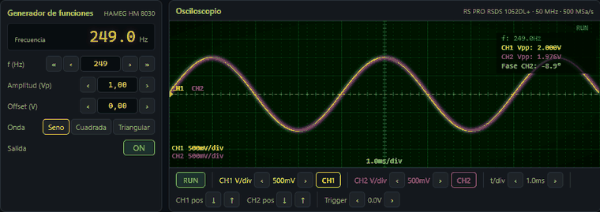

# Lab Virtual de Electrónica

Simulador web interactivo de laboratorio de electrónica analógica.

**▶ [Probar la demo en el navegador](https://ricardoeee.github.io/Modelo-laboratorio-electronica/)**: no hace falta instalar nada.



## Equipos simulados

| Equipo | Modelo real |
|---|---|
| Osciloscopio de 2 canales | RS PRO RSDS 1052DL+ |
| Fuente triple de alimentación | HAMEG HM 8030-5 |
| Generador de funciones | HAMEG HM 8030 |
| Protoboard | KBH GL-23 |

## Experimentos incluidos

1. Filtro RC Paso Bajo
2. Filtro RC Paso Alto
3. Filtro RL Paso Bajo
4. Filtro RL Paso Alto
5. Amplificador Inversor (Op-Amp)
6. Amplificador No Inversor (Op-Amp)
7. **Integrador con Op-Amp** ← circuito del laboratorio real
8. Diferenciador con Op-Amp
9. Amplificador Emisor Común (BJT)
10. Rectificador de Media Onda
11. Rectificador de Onda Completa (Puente)

Cada experimento incluye guía paso a paso, parámetros ajustables en tiempo real, su montaje de referencia en la protoboard
y medidas automáticas en el osciloscopio (frecuencia de CH1 y CH2, Vpp y desfase).

## Protoboard libre

Montas el circuito agujero a agujero: generador (**Gen**), componentes, cables y sonda (**CH2**). El carril de abajo es GND y el de arriba, V+. El detector mira la conexión real (nodos, cables, polaridad y pines del op-amp y del transistor), te dice qué falta y, si el montaje coincide con uno de los 11 experimentos, calcula CH2 con los valores que hayas puesto.

**No es un resolvedor general de circuitos:** cualquier otro montaje no da señal en CH2. No modela la alimentación del op-amp, que se toma de la fuente, ni la masa flotante del puente: CH2 mide entre + y −.

## Cómo usar

```bash
# Cualquier servidor HTTP estático funciona:
python3 -m http.server 8080
# Luego abre http://localhost:8080
```

> **No** abrir con `file://` — los ES Modules requieren HTTP.

## Pruebas

```bash
node --test
```

Hace falta Node 20 o superior. Contrastan con el cálculo las medidas del osciloscopio (frecuencia, Vpp y fase de filtros, op-amp, transistor y rectificadores), lo que se ve en pantalla y las cifras de la guía. También pasan el montaje de cada experimento por el detector de la protoboard.

## Cómo está hecho

Hecho con ayuda de IA. Las medidas de los 11 experimentos se comprueban con pruebas contra la teoría.

El transistor es un modelo lineal por tramos con RE sin desacoplar: punto de trabajo, ganancia y recorte salen del cálculo, no de un modelo de Ebers-Moll. El rectificador usa un diodo ideal con caída fija. Lo que se toca con el ratón se ha probado a mano en el navegador; no hay pruebas automáticas de la interfaz.

## Tecnología

- HTML5 + CSS3 + JavaScript ES Modules puro — sin frameworks ni build tools
- Canvas API para el osciloscopio (persistencia de fósforo, grid CRT)
- Motor analítico de circuitos (filtros IIR digitales equivalentes a H(jω))
